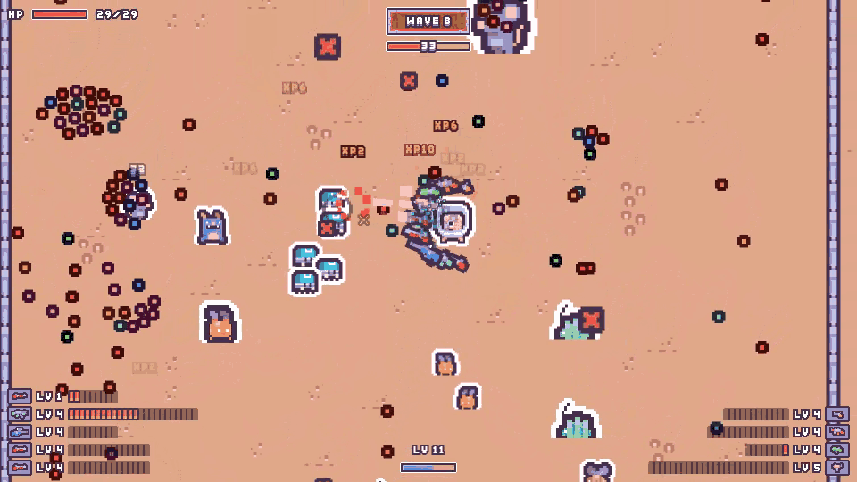
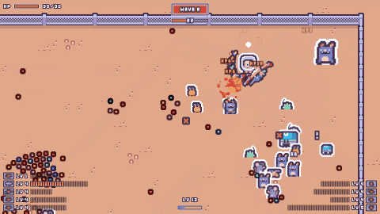
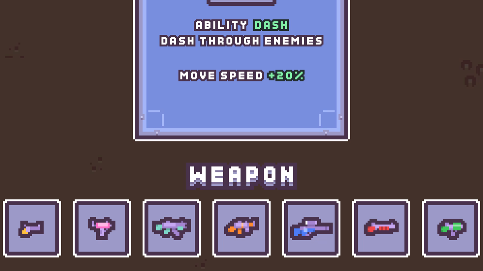
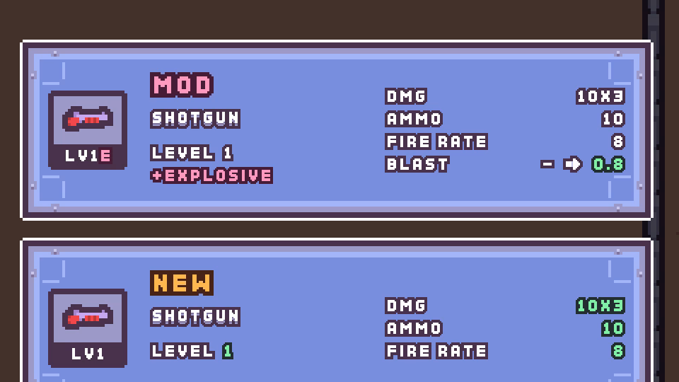
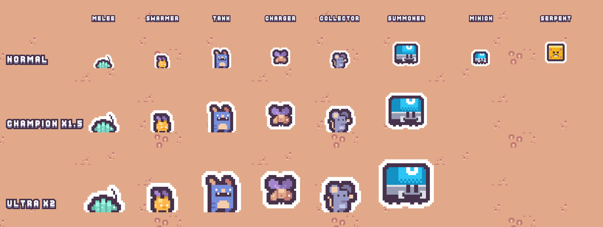
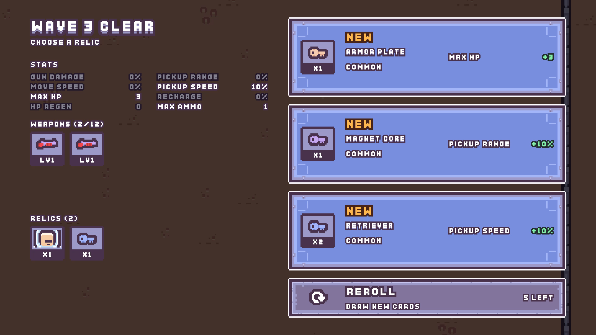
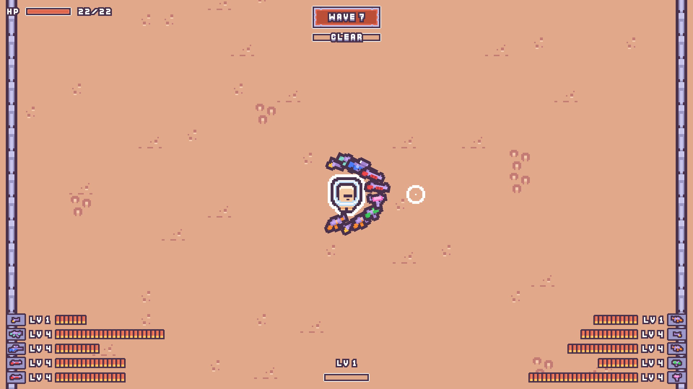
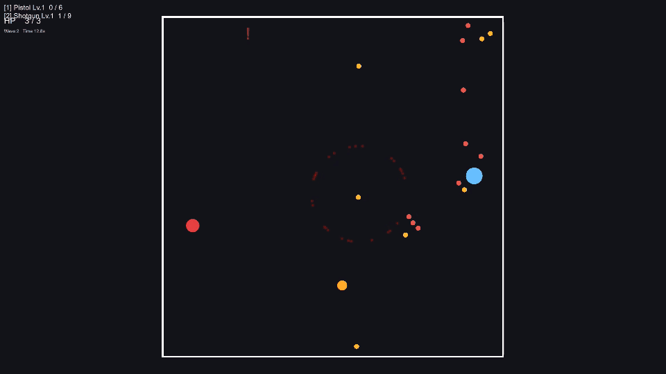

**English** · [한국어](README.ko.md)

# Pick & Shoot

**A top-down shooter where you pick up every bullet you fire**

Unity 6 prototype · Sep – Oct 2026 · Paused

https://github.com/user-attachments/assets/0e4f5792-4f5f-472d-8d35-99d7b47b8456

🔊 This video has sound — GitHub plays it muted, so click the speaker icon in the player

 

## Contents

- [What it is](#what-it-is)
- [Play](#play)
- [Development history](#development-history)
- [How it was made](#how-it-was-made)
- [Retrospective](#retrospective)

 

## What it is

<table>
  <tr>
    <td width="50%" align="center">
       
      <b>Bullets</b> Every bullet you fire stays on the ground. Walk close and it flies back to its gun.
    </td>
    <td width="50%" align="center">
       
      <b>Weapons</b> Seven guns, from pistol to launcher. Level them up and carry up to 12 at once.
    </td>
  </tr>
  <tr>
    <td width="50%" align="center">
       
      <b>Mods</b> Explosive, homing, ricochet and drill. Each one changes the bullets of one gun.
    </td>
    <td width="50%" align="center">
       
      <b>Enemies</b> Six types and a serpent boss that splits. Bigger champions and ultras join later.
    </td>
  </tr>
  <tr>
    <td width="50%" align="center">
       
      <b>Growth</b> Pick one card after every wave. Three characters, each with its own ability.
    </td>
    <td width="50%" align="center">
       
      <b>Screen</b> A hand-built pixel UI for the HUD and cards on top of Kenney CC0 art.
    </td>
  </tr>
</table>

 

## Play

### [https://kangtoe.github.io/Pick-Shoot/](https://kangtoe.github.io/Pick-Shoot/)

Desktop browser with keyboard and mouse · sound starts after your first click

- **Editor** — open with Unity **6000.3.10f1** and play `Assets/Scenes/SampleScene`.
- Debug tools: menu `PickShoot/Debug Tools` — add weapons, mods and relics, spawn enemies, end the wave instantly

| Controls | |
|---|---|
| Move | <kbd>W</kbd> <kbd>A</kbd> <kbd>S</kbd> <kbd>D</kbd> |
| Aim · shoot | Mouse · left click |
| Ability | <kbd>Space</kbd> |
| Pause | <kbd>Esc</kbd> — `MAIN MENU` on the pause screen goes back to the start |
| Restart (after death) | <kbd>R</kbd> |

 

## Development history

How it changed over five weeks and about 300 commits.

 
<b>Sep 15</b> · The first prototype, built from plain shapes (<a href="https://github.com/kangtoe/Pick-Shoot/tree/3556418"><code>3556418</code></a>)

| When | Stage | What was done | Commits |
|---|---|---|---|
| Sep 9 – 15 | Core loop | Bullets you fire, leave behind and pick up; enemies and endless waves; weapon pickup and level-up cards — all tried out with plain shapes | [`825a124`…`6bdd10c`](https://github.com/kangtoe/Pick-Shoot/commits/6bdd10c) · 53 |
| Sep 16 – 22 | Art · roguelike | Kenney pixel art and pixel UI, 12 weapon slots, dash | [`1c1a4d7`…`d5f90dc`](https://github.com/kangtoe/Pick-Shoot/compare/6bdd10c...d5f90dc) · 107 |
| Sep 24 – Oct 2 | Enemies · weapons | Launcher and explosions; charger, serpent boss, collector, summoner; auto-recording bot | [`ace2f90`…`0275702`](https://github.com/kangtoe/Pick-Shoot/compare/d5f90dc...0275702) · 68 |
| Oct 4 – 14 | Builds | 7 relics, 4 mods, 3 characters; every gun fires on its own; reworked reward screen and build grid | [`4f20e4e`…`6e19195`](https://github.com/kangtoe/Pick-Shoot/compare/0275702...6e19195) · 61 |
| Oct 14 – 15 | Paused · release | Wrote down why it stopped and when to resume, then prepared the release — trailer, README, web build | [`6e93915`…](https://github.com/kangtoe/Pick-Shoot/compare/6e19195...main) |

 

## How it was made

Built with [Claude Code](https://claude.com/claude-code), an AI coding agent. I set the direction and made the calls; implementation, documentation and verification tooling were shared with the agent. The linked documents are in Korean.

| Rule | What it means |
|---|---|
| **Docs are the single source of truth** | Rules and numbers live in the [GDD](Docs/GDD.md) and [system docs](Docs/Systems/); decisions and their reasons in the [Roadmap](Docs/Roadmap.md). |
| **Choose from mockups first** | UI layouts were picked by comparing several mockups built from the real sprites. |
| **Verify without the editor** | Every script is compiled and game logic is run from the shell ([OfflineVerification](Docs/Guides/OfflineVerification.md)). |
| **Auto-recording bot** | A bot plays the game and records it automatically — the media on this page was made that way ([AutoPlayRecording](Docs/Guides/AutoPlayRecording.md)). |
| **Fail loudly** | Invalid states are never passed over silently; they are reported with their cause. |
| **Portable guides** | Procedures that work in other projects are kept separately in [Docs/Guides](Docs/Guides/). |

 

## Retrospective

Paused after five weeks and about 300 commits. 
The day-by-day account is in the [pause record](Docs/Roadmap.md#현재-위치-2026-10-14) (Korean).

### ① I put two systems pulling in opposite directions at the core

Picking bullets up only becomes a decision — where to shoot, when to go collect — when each bullet is **scarce**. 
But Brotato-style multiple weapons, simultaneous fire and growth **multiply** your bullets and lower the value of each one.

Multiple weapons arrived just **two days** after pickup was first implemented (Sep 11), one stage ahead of plan. 
Six days later you could carry 12 guns. 
The system pulling the other way settled in before I had checked whether picking up was fun.

Almost every pickup rule I changed during playtesting made you pick up **less**.

- `Sep 14` pull in every leftover bullet when a wave ends
- `Sep 21` bullets caught by the magnet follow you all the way
- `Oct 1` collect bullets that are still in flight

> [!WARNING]
> Removing the inconveniences one by one was removing the core.

### ② When content ran out, I added combinations

Bullet color coding and the reward card pool meant I couldn't add more weapons. 
So on the day I cut six variant weapons (Oct 9), I designed **mods** that attach to a weapon.

But the weapons already barely differed.

- Every weapon fires at its own rate, all at once.
- Early enemies die in one hit.
- No weapon bounces off walls.

4 mods × 7 weapons — **28 combinations** — didn't change how it felt. My note at the time: *"punchier, yet flat"* (Oct 12). 
Relics and characters, too, either left pickup alone or made it less necessary.

> [!WARNING]
> Combinations amplify the differences between elements; they can't create differences that aren't there.

### ③ I kept expanding while putting off the core question three times

**"Is moving to pick bullets up more fun than it is tedious?"** 
That was the most important question from the start ([GDD §5](Docs/GDD.md#5-mvp-테스트-기준)).

- **Closing Phase 2** — moved on to "verify again later" without a verdict.
- **Closing Phase 3** — deferred it, saying there wasn't enough content to judge.
- **Oct 13** — decided to build out the variety first and judge everything at once.

By the time I stopped, answering it meant changing the skeleton. 
One or two weapons, growth that raises the value of a single bullet instead of the bullet count — effectively a new game. 
Weighed on equal footing against my other projects in progress, this is where it stopped.

> [!WARNING]
> Every delay stacked more systems on top and raised the cost of answering.

### What I'm taking to the next project

> [!TIP]
> **Before adding a system** — does it grow or shrink the core resource? 
> If it pulls against the core, decide first which one is in charge.
>
> **Before adding combinations** — do the elements already feel different from each other in play? 
> If not, more combinations won't bring them to life.

> [!NOTE]
> **What carries over** — the UI/UX of the reward choice screen is written up as the [RewardChoiceUX](Docs/Guides/RewardChoiceUX.md) guide. 
> Procedures such as verifying without the editor and the auto-recording bot are in [Docs/Guides](Docs/Guides/), written to work in any project.

 

## Tech · docs

- Unity 6 (URP 2D) · C# · Input System · ScriptableObject data · IMGUI pixel UI
- [Docs/README.md](Docs/README.md) — document index · [GDD](Docs/GDD.md) · [Roadmap](Docs/Roadmap.md) · [DEVELOPMENT](DEVELOPMENT.md) (all in Korean)

 

## Credits · license

All in-game art and sound effects are CC0 assets by [Kenney](https://kenney.nl) — Desert Shooter Pack, Pixel Platformer, Cursor Pixel Pack. Some images in `Assets/Art` are copies of them with adjusted outlines or colors. 
The trailer uses [Dope Video Game Boss Music](https://freesound.org/s/683457/) by Seth_Makes_Sounds (CC0), sound effects from the Sonniss GDC bundle and Kenney (CC0), and Kenney Fonts (CC0) for the captions.

The code and documents are copyright kangtoe (All rights reserved). They are published as a portfolio and may not be used, copied, modified or distributed without permission. Kenney assets remain CC0 — see [LICENSE](LICENSE).
