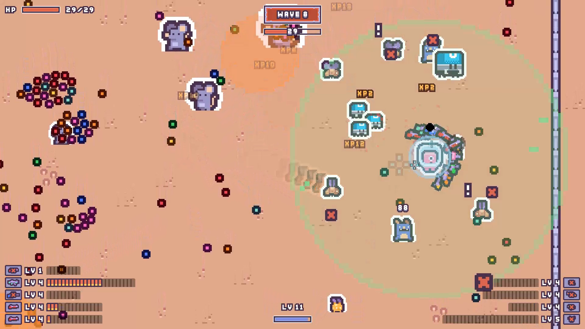
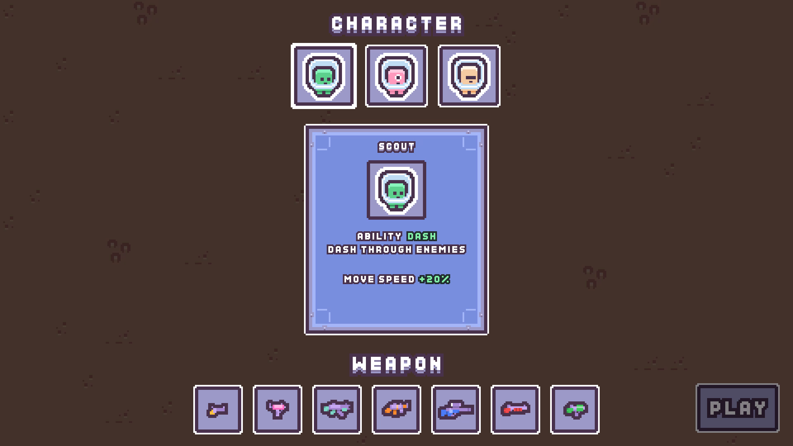
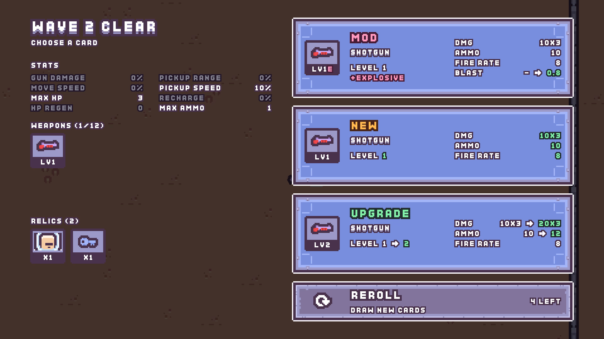

# Pick & Shoot

**발사한 탄환을 회수하며 싸우는 탑다운 슈팅**

Unity 6 프로토타입 · 2026.09 – 10 · 잠정 중단

https://github.com/user-attachments/assets/0e4f5792-4f5f-472d-8d35-99d7b47b8456

🔊 소리가 있는 영상입니다 — GitHub는 음소거로 재생하니 플레이어의 스피커 아이콘을 눌러 켜 주세요

[어떤 게임인가요](#어떤-게임인가요) · [실행](#실행) · [만든 것](#만든-것) · [개발 과정](#개발-과정) · [개발 방법](#개발-방법) · [회고](#회고)

> *A top-down roguelike shooter where every bullet you fire stays on the field — walk over it to reload. Built in five weeks with Unity 6 (URP 2D) and documented end to end, then paused once it became clear its growth systems were working against the core loop. Docs are in Korean; the [retrospective](#회고) explains why it stopped.*

---

## 어떤 게임인가요

**쏜다 → 탄이 전장에 남는다 → 주우러 간다 → 다시 쏜다**

- **쏜 탄은 바닥에 남습니다** 사라지지 않고, 가까이 가면 자석처럼 끌려와 다시 장전됩니다.
- **탄이 떨어지면 주우러 갑니다** 적 사이로 들어가야 하니, 어디에 쏘고 언제 주울지가 핵심입니다.
- **웨이브마다 빌드를 키웁니다** 무기·개조·유물을 고르고, 무기는 최대 12자루까지 동시에 쏩니다.

<table>
  <tr>
    <td colspan="2" align="center">
       
      <b>전투</b> — 웨이브 8, 회수 펄스와 바닥에 쌓인 탄
    </td>
  </tr>
  <tr>
    <td width="50%" align="center">
       
      <b>시작</b> — 캐릭터 3종과 시작 무기 고르기
    </td>
    <td width="50%" align="center">
       
      <b>보상</b> — 웨이브마다 개조·새 무기·강화 중 하나
    </td>
  </tr>
</table>

**플레이 영상** — 웨이브 1부터 4까지 2분 (자동 플레이 봇) · 🔊 소리는 플레이어에서 켜 주세요

https://github.com/user-attachments/assets/332c39ac-b163-4099-be50-e3d989c68cdb

 

## 실행

- Unity **6000.3.10f1**로 열고 `Assets/Scenes/SampleScene`을 플레이합니다.
- 디버그 도구: 메뉴 `PickShoot/Debug Tools` — 무기·개조·유물 추가, 적 소환, 웨이브 즉시 종료

| 조작 | |
|---|---|
| 이동 | <kbd>W</kbd> <kbd>A</kbd> <kbd>S</kbd> <kbd>D</kbd> |
| 조준 · 사격 | 마우스 · 좌클릭 |
| 능력 | <kbd>Space</kbd> |
| 일시정지 | <kbd>Esc</kbd> |
| 재시작 (사망 후) | <kbd>R</kbd> |

 

## 만든 것

<table>
  <tr>
    <td width="50%" align="center">
       
      <b>탄환</b> 쏜 탄은 튕기다가 바닥에 멈춰 남고, 가까이 가면 쏜 무기로 돌아갑니다.
    </td>
    <td width="50%" align="center">
       
      <b>무기</b> 권총부터 런처까지 7종. 자루마다 레벨업하며 최대 12자루를 함께 씁니다.
    </td>
  </tr>
  <tr>
    <td width="50%" align="center">
       
      <b>개조</b> 폭발·유도·도탄·천공 4종. 무기 한 자루에 붙어 탄의 성질을 바꿉니다.
    </td>
    <td width="50%" align="center">
       
      <b>적</b> 수집형·소환사·돌진형 등 6종과 분열하는 서펜트 보스. 후반엔 1.5배 챔피언과 2배 울트라가 섞입니다.
    </td>
  </tr>
  <tr>
    <td width="50%" align="center">
       
      <b>성장</b> 웨이브마다 카드 3장 중 하나 — 새 무기·강화·개조·유물. 캐릭터 3종은 능력이 다릅니다.
    </td>
    <td width="50%" align="center">
       
      <b>화면</b> Kenney CC0 그림 위에 직접 그린 픽셀 UI입니다.
    </td>
  </tr>
</table>

 

## 개발 과정

5주, 커밋 약 300개 동안의 변화입니다.

 
<b>09-15</b> · 도형으로 만든 첫 프로토타입 (<a href="https://github.com/kangtoe/Pick-Shoot/tree/3556418"><code>3556418</code></a>)

| 시기 | 단계 | 한 일 | 커밋 |
|---|---|---|---|
| 09-09 ~ 09-15 | 핵심 루프 | 쏘고·남기고·줍는 탄환, 적과 무한 웨이브, 무기 획득·레벨업 카드를 도형으로 만들어 확인 | [`825a124`…`6bdd10c`](https://github.com/kangtoe/Pick-Shoot/commits/6bdd10c) · 53 |
| 09-16 ~ 09-22 | 아트 · 로그라이크 | Kenney 픽셀 아트와 픽셀 UI, 무기 12자루 슬롯, 대시 | [`1c1a4d7`…`d5f90dc`](https://github.com/kangtoe/Pick-Shoot/compare/6bdd10c...d5f90dc) · 107 |
| 09-24 ~ 10-02 | 적 · 무기 | 런처와 폭발, 돌진형·서펜트 보스·수집형·소환사, 자동 녹화 봇 | [`ace2f90`…`0275702`](https://github.com/kangtoe/Pick-Shoot/compare/d5f90dc...0275702) · 68 |
| 10-04 ~ 10-14 | 빌드 | 유물 7종·개조 4종·캐릭터 3종, 자루마다 동시 사격, 보상 화면과 빌드 격자 개편 | [`4f20e4e`…`6e19195`](https://github.com/kangtoe/Pick-Shoot/compare/0275702...6e19195) · 61 |
| 10-14 | 잠정 중단 | 회고를 남기고 공개 준비 — 적 등급·챔피언, 영상, README | [`6e93915`…](https://github.com/kangtoe/Pick-Shoot/compare/6e19195...main) |

 

## 개발 방법

[Claude Code](https://claude.com/claude-code)(AI 코딩 에이전트)와 함께 만들었습니다. 방향과 판단은 사람이, 구현·문서화·검증 자동화는 에이전트와 나눠 맡았습니다.

| 규칙 | 내용 |
|---|---|
| **문서가 단일 출처** | 규칙·수치는 [GDD](Docs/GDD.md)·[시스템 문서](Docs/Systems/)에, 결정과 이유는 [Roadmap](Docs/Roadmap.md)에 둡니다. |
| **목업으로 먼저 고르기** | UI는 실제 스프라이트로 만든 목업 여러 안을 비교해 골랐습니다. |
| **에디터 없이 검증** | 셸에서 전체 스크립트를 컴파일하고 로직을 돌려 봅니다 ([OfflineVerification](Docs/Guides/OfflineVerification.md)). |
| **자동 녹화 봇** | 봇이 플레이하는 영상을 자동으로 찍습니다. 이 페이지의 그림도 그렇게 만들었습니다 ([AutoPlayRecording](Docs/Guides/AutoPlayRecording.md)). |
| **실패는 크게** | 잘못된 상태는 조용히 넘기지 않고 원인과 함께 알립니다. |
| **옮겨 쓰는 가이드** | 다른 프로젝트에도 쓸 절차는 [Docs/Guides](Docs/Guides/)에 따로 둡니다. |

 

## 회고

5주, 커밋 약 300개 끝에 잠정 중단했습니다. 
날짜별 경위는 [중단 기록](Docs/Roadmap.md#현재-위치-2026-10-14)에 있습니다.

### ① 서로 반대로 당기는 시스템을 함께 핵심에 두었습니다

회수는 탄 한 발이 **귀해야** "어디에 쏘고 언제 주울지"가 판단이 됩니다. 
그런데 브로타토식 다중 무기·동시 사격·성장은 탄을 **늘려** 한 발의 가치를 낮춥니다.

다중 무기는 회수를 처음 구현한 지 **이틀 뒤**(09-11), 계획보다 한 단계 앞당겨 들어왔습니다. 
엿새 뒤엔 최대 12자루가 됐습니다. 
회수가 재미있는지 확인하기 전에, 반대 방향의 시스템이 먼저 자리를 잡았습니다.

플레이하며 고친 회수 규칙도 거의 모두 회수를 **덜 하게** 만드는 쪽이었습니다.

- `09-14` 웨이브가 끝나면 남은 탄을 모두 끌어오기
- `09-21` 자석에 걸린 탄은 끝까지 따라오기
- `10-01` 날아가는 탄도 회수하기

> [!WARNING]
> 불편을 하나씩 걷어 낸 것이 곧 핵심을 깎아 낸 것이었습니다.

### ② 콘텐츠가 막히자 조합을 늘렸습니다

탄 색 구분과 보상 카드 풀 때문에 무기를 더 늘릴 수 없었습니다. 
그래서 변형 무기 6종을 뺀 날(10-09), 무기에 붙이는 **개조**를 기획했습니다.

하지만 무기끼리의 차이가 이미 거의 없었습니다.

- 모든 무기가 제 속도로 동시에 쏩니다.
- 초반 적은 한 발에 죽습니다.
- 어떤 무기도 벽에 튕기지 않습니다.

개조 4종 × 무기 7종, **28조합**도 체감을 바꾸지 못했습니다. 그때 남긴 메모는 *"시원해지면서도 밋밋"* (10-12). 
유물·캐릭터도 회수를 건드리지 않거나 덜 필요하게 만들었습니다.

> [!WARNING]
> 조합은 요소 사이의 차이를 키울 뿐, 없는 차이를 만들지는 못합니다.

### ③ 핵심 질문을 세 번 미룬 채 확장했습니다

**"회수하러 움직이는 것이 귀찮음보다 재미있는가"** 
처음부터 가장 중요한 검증 질문이었습니다 ([GDD §5](Docs/GDD.md#5-mvp-테스트-기준)).

- **Phase 2를 닫을 때** — 판정 없이 재검증으로 넘겼습니다.
- **Phase 3을 닫을 때** — 콘텐츠가 모자라 판단할 수 없다며 이월했습니다.
- **10-13** — 빌드의 폭을 먼저 갖추고 한 번에 보기로 했습니다.

멈춘 시점에는 질문에 답하려면 뼈대부터 바꿔야 했습니다. 
무기 1~2자루, 탄 수 대신 한 발의 가치를 키우는 성장 — 사실상 새 게임입니다. 
진행 중인 다른 프로젝트와 같은 출발선에서 비교해, 여기서 멈췄습니다.

> [!WARNING]
> 미룰 때마다 그 위에 시스템이 쌓여, 답하는 비용이 커졌습니다.

### 다음 프로젝트로 가져가는 것

> [!TIP]
> **시스템을 더하기 전에** — 이 시스템은 핵심 자원을 늘리는가, 줄이는가? 
> 핵심과 반대 방향이면 어느 쪽이 주인인지 먼저 정한다.
>
> **조합을 늘리기 전에** — 섞을 요소들이 플레이에서 이미 서로 다르게 느껴지는가? 
> 아니라면 조합을 늘려도 살아나지 않는다.

> [!NOTE]
> **살려 가는 것** — 보상 선택 화면의 UI/UX는 [RewardChoiceUX](Docs/Guides/RewardChoiceUX.md) 가이드로 정리했습니다. 
> 에디터 없이 검증하기·자동 녹화 봇 같은 절차도 [Docs/Guides](Docs/Guides/)에 프로젝트와 상관없이 쓰도록 남겼습니다.

 

## 기술 · 문서

- Unity 6 (URP 2D) · C# · Input System · ScriptableObject 데이터 · IMGUI 픽셀 UI
- [Docs/README.md](Docs/README.md) — 문서 색인 · [GDD](Docs/GDD.md) · [Roadmap](Docs/Roadmap.md) · [DEVELOPMENT](DEVELOPMENT.md)

 

## 크레딧 · 라이선스

그림과 효과음은 모두 [Kenney](https://kenney.nl)의 CC0 에셋입니다 — Desert Shooter Pack, Pixel Platformer, Cursor Pixel Pack. 소개 영상의 자막 글꼴은 Kenney Fonts(CC0)입니다.

코드와 문서의 저작권은 kangtoe에게 있습니다 (All rights reserved). 포트폴리오로 보여 드리려고 공개한 것이며, 허락 없이 사용·복제·수정·배포할 수 없습니다. Kenney 에셋은 CC0 그대로입니다 — [LICENSE](LICENSE).
