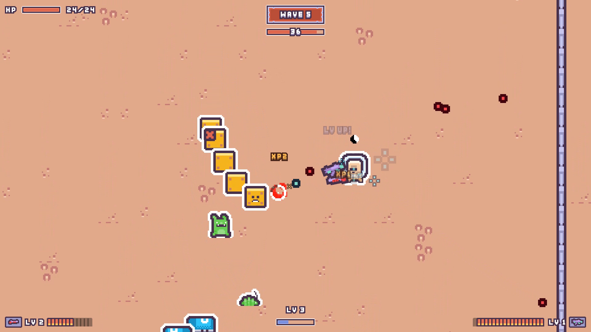

# Pick & Shoot

> **내가 쏜 총알을 다시 주워야 살아남는 탑다운 로그라이크 슈팅** — Unity 6 프로토타입 (2026.09–10, 잠정 중단)


<!-- 영상 링크: GitHub 웹에서 이 파일을 편집하며 mp4를 끌어다 놓으면 플레이어가 붙는다. 붙인 뒤 아래 줄을 그 링크로 바꾼다. -->
**▶ 소개 영상 (1분) · 플레이 영상 (2분)**

*A top-down roguelike shooter where every bullet you fire stays on the field — walk over it to reload. Built in five weeks with Unity 6 (URP 2D) and documented end to end, then paused once it became clear its growth systems were working against the core loop. Docs are in Korean; the [retrospective](#회고) explains why it stopped.*

---

## 어떤 게임인가

```
Pick → Shoot → Pick → Shoot
```

- 쏜 탄환은 사라지지 않고 전장에 남는다. 가까이 가면 자석처럼 끌려와 **쏜 무기의 탄창**으로 돌아간다.
- 탄이 떨어지면 적 사이로 주우러 들어가야 한다. 어디에 쏘고 언제 주우러 갈지가 전투의 판단이다.
- 웨이브를 넘길 때마다 무기·개조·유물 중 하나를 고르며 빌드를 쌓는다. 무기는 최대 12자루가 한 버튼으로 동시에 쏜다.

| | |
|---|---|
|  |  |
|  |  |

## 만든 것

| 영역 | 내용 |
|---|---|
| 탄환 | 튕김 → 정착 두 단계, 튕김·관통 카운트, 벽·화면 가장자리 반사, 자석 회수(날아가는 탄도 잡힌다), 무기별 귀속 탄창 |
| 무기 | 7종 — 권총·SMG·기관총·어썰트 라이플(3점사)·스나이퍼 라이플(관통)·산탄총·런처(폭발). 자루 단위 레벨업, 최대 12자루 동시 사격 |
| 개조 | 폭발·유도·도탄·천공 — 자루 하나에 붙어 탄환이 날고 부딪히는 방식을 바꾼다 |
| 적 | 6종 + 보스 — 예고 뒤 돌진, 졸개를 쏘는 소환사, **떨어진 탄을 훔쳐 가는 수집형**, **몸통을 끊으면 분열하는 서펜트 보스** |
| 성장 | 웨이브 보상 3택(유물 ↔ 무기 교대), 레벨 업으로 적립하는 리롤, 커먼 유물 7종, 캐릭터 3종과 능력(대시·회수 펄스·충격파) |
| 화면 | IMGUI로 직접 그린 정수 배율 픽셀 UI — HUD, 탄약 링 크로스헤어, 보상 화면, 빌드 격자, 보기 카드, 스탯 표. 16:9 고정 |

## 개발 방법

[Claude Code](https://claude.com/claude-code)(AI 코딩 에이전트)와 함께 만들었다. 방향을 정하고, 플레이해 보고, 판정하는 일은 사람이 했고, 구현·문서화·검증 자동화는 에이전트와 나눠 했다. 그 과정을 굴러가게 한 규칙들:

- **문서가 단일 출처** — 규칙·수치는 [GDD](Docs/GDD.md)와 [시스템 문서](Docs/Systems/), 결정의 날짜·이유·버린 안은 [Roadmap](Docs/Roadmap.md)에 둔다. 코드 주석은 "왜"를 적고 문서의 절을 가리킨다.
- **목업으로 먼저 고르기** — UI 배치는 실제 스프라이트 시트 조각을 정수 배율로 합성한 목업 2~4안을 나란히 놓고 골랐다. 에디터에 넣는 것은 고른 안 하나뿐이다.
- **에디터 없이 검증** — Unity에 들어 있는 Roslyn으로 전체 스크립트를 셸에서 컴파일하고, 로직은 스텁 하니스로 돌린다 ([OfflineVerification](Docs/Guides/OfflineVerification.md)).
- **자동 녹화 봇** — 요청 파일 하나로 플레이 모드 진입 → 봇 플레이 → mp4 저장 → 종료까지 간다. 이 페이지의 영상도 그렇게 찍었다 ([AutoPlayRecording](Docs/Guides/AutoPlayRecording.md)).
- **실패는 크게** — 조용히 넘어가는 방어 코드 대신, 잘못된 데이터와 상태를 원인과 함께 예외로 알린다.
- **옮겨 쓰는 가이드** — 프로젝트와 무관한 원칙·절차는 [Docs/Guides](Docs/Guides/)에 따로 두고 다른 프로젝트에 복사해 쓴다.

## 회고

5주, 커밋 약 300개 끝에 잠정 중단했다 ([중단 기록](Docs/Roadmap.md#현재-위치-2026-10-14)).

- **맞지 않는 시스템을 함께 핵심에 두었다.** 회수는 탄 한 발이 귀해야 판단이 되는데, 브로타토식 다중 무기·동시 사격·성장은 탄을 늘려 한 발의 가치를 낮춘다. 플레이에서 나온 회수 수정도 대부분 회수를 덜 하게 만드는 쪽이었다.
- **콘텐츠가 막히자 레이어를 더했지만, 레이어는 바닥의 차이를 곱할 뿐이다.** 무기 사이의 차이가 이미 0에 가까워 개조 28조합도 체감을 바꾸지 못했다.
- **핵심 질문("회수가 귀찮음보다 재미있는가")을 세 번 미룬 채 확장했다.**

다음 프로젝트로 가져가는 질문 둘:

1. 시스템을 더하기 전에 — 이 시스템은 핵심 자원을 늘리는가, 줄이는가?
2. 레이어를 더하기 전에 — 바닥의 요소들이 플레이에서 이미 다르게 느껴지는가?

살린 것 — 보상 선택 화면의 UI/UX는 [RewardChoiceUX](Docs/Guides/RewardChoiceUX.md) 가이드로 정리했다.

## 실행

- Unity **6000.3.10f1**로 열고 `Assets/Scenes/SampleScene`을 플레이한다.
- 조작: **WASD** 이동 · **마우스** 조준 · **좌클릭** 사격 · **Space** 능력 · **ESC** 일시정지 · 사망 후 **R** 재시작
- 디버그 도구: 메뉴 `PickShoot/Debug Tools` — 무기·개조·유물 추가, 적 소환, 웨이브 즉시 종료

## 기술

Unity 6 (URP 2D) · C# · Input System · ScriptableObject 데이터 · IMGUI 픽셀 UI

## 문서

- [Docs/README.md](Docs/README.md) — 문서 색인
- [GDD](Docs/GDD.md) · [Roadmap](Docs/Roadmap.md) · [DEVELOPMENT](DEVELOPMENT.md)

## 크레딧

그림과 효과음은 모두 [Kenney](https://kenney.nl)의 CC0 에셋이다 — Desert Shooter Pack, Pixel Platformer, Cursor Pixel Pack. 소개 영상의 자막 글꼴은 Kenney Fonts(CC0).
